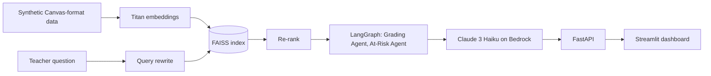

# EduAI Connect

**Status: In progress.** The hosted app runs on Streamlit Cloud with a fixed sample of 12 synthetic
students and preset risk levels. Its chat answers questions with Claude Haiku 4.5 on Amazon Bedrock,
grounded in the student records it retrieves, when the app has AWS credentials; without them it
shows the matching records and says no AI answer was generated. Full mode (RAG and agents) runs
locally only; its accuracy has not been measured and it has never been deployed.

Independent reference project by Shoot It Analytics LLC. Built with public or synthetic data.

Demo (Streamlit Cloud): https://eduai-connect-horner.streamlit.app

## What it does

EduAI Connect is meant to help a teacher see which students may be falling behind and what to try
next, by asking plain-language questions about grades, attendance and engagement.

- **Hosted app** (`streamlit_app/streamlit_app.py`): a class dashboard, an at-risk list, student
  profiles and a system page, built on a fixed sample of 12 synthetic students whose risk levels are
  preset in the code, plus a chat page (`streamlit_app/live_chat.py`):
  - Retrieval: keyword matching. A question that names students gets only their records; any other
    question gets the whole class, ordered by the topic it asks about (risk, attendance, GPA,
    missing work or a subject). No embeddings.
  - Answer: Claude Haiku 4.5 on Amazon Bedrock (Converse API, `us.` inference profile), told to use
    only the retrieved records and cite their IDs. The records sent to the model are shown under
    every answer, and a citation of a record that was not retrieved is flagged.
  - Safety: credentials only from Streamlit secrets `[aws]`; at most 10 live AI requests per browser
    session; one audit log entry per answer (question, record IDs, model, tokens, cost, latency);
    with no credentials, a clearly labeled demo mode that shows records and no AI text.
- **Full mode** (AWS credentials): synthetic student records are embedded with Amazon Titan Text
  Embeddings v2 into a FAISS index; questions are rewritten, results re-ranked, and Claude 3 Haiku on
  Amazon Bedrock answers. A LangGraph workflow runs a Grading Agent and an At-Risk Agent; the
  At-Risk Agent asks the model to apply three explicit criteria (grade below 70, attendance below
  0.80, engagement below 60). A FastAPI backend serves `/health`, `/chat`, `/insights/grading` and
  `/insights/at-risk`.
- An MCP server (`mcp_server.py`) exposes the same analytics to MCP clients.

All student data is synthetic, in Canvas LMS API format. No real student records have been used.

## Why I built this

**The problem.** Teachers often learn that a student is struggling only after a failed test or
report card, when it is late to help. The signals are usually already in the school's systems
(grades, attendance, assignment completion) but spread across screens nobody has time to read.

**What I set out to prove.** Whether a retrieval-and-agents design can answer a teacher's plain
questions about their class from those records, with explicit and explainable at-risk criteria, while
keeping student data inside the school's own cloud account.

**Key design decisions**
- **Data:** synthetic Canvas-format records only, so the design can be shown without any student data.
- **Explainable criteria:** the at-risk thresholds are written in the prompt and documented, not
  learned from data nobody can inspect.
- **Model:** Claude 3 Haiku for low cost per question; Titan embeddings and FAISS so the index can
  live in the school's AWS account.
- **Guardrails (partly built):** a script creates a Bedrock Guardrail for PII, but it is not applied
  to the chat chain yet. See [docs/FERPA_COMPLIANCE.md](docs/FERPA_COMPLIANCE.md) for what is built.
- **Cost:** the demo needs no AWS account; full mode uses the cheapest Claude model.

**Results.** No accuracy, false positive rate or hallucination rate has been measured yet. What is
measured: 11 automated tests (every demo page renders, the synthetic data loads, the API answers its
health check, the MCP server imports).

**Limits.** Synthetic data only; never used with real students. Not FERPA compliant as it stands,
and not a certified or regulated product. Several privacy controls are designed but not built.

**What I'd do next in a real deployment.** Apply the guardrail to every model call, add real
authentication and per-section access in the API, add audit logging, measure accuracy and false
positives on de-identified historical data with the school's permission, test for differences across
student groups, and complete the district's privacy review.

## Architecture



Infrastructure as code: `terraform/main.py` is an AWS CDK app (despite the folder name) that defines
a KMS key, a KMS-encrypted S3 bucket, a log group, an ingestion Lambda and EventBridge schedules. It
has not been deployed.

## How to run

```bash
git clone https://github.com/johnathan-horner/eduai-connect.git
cd eduai-connect
```

Hosted app (no AWS account needed; the chat then runs in demo mode):

```bash
pip install -r requirements.txt
streamlit run streamlit_app/streamlit_app.py
```

To turn on live AI answers, add this to `.streamlit/secrets.toml` (never commit it) or to the app's
Secrets on Streamlit Cloud. The key needs only `bedrock:InvokeModel` on the Claude Haiku 4.5 `us.`
inference profile and its foundation model:

```toml
[aws]
access_key_id = "YOUR_ACCESS_KEY_ID"
secret_access_key = "YOUR_SECRET_ACCESS_KEY"
region = "us-east-1"
```

The chat audit log is written to `logs/chat_audit.jsonl` (set `EDUAI_AUDIT_LOG` to change it). On
Streamlit Cloud it resets whenever the app restarts.

Full mode (Python 3.11+, AWS credentials that can call Bedrock, model access for Claude 3 Haiku and
Titan Text Embeddings v2):

```bash
pip install -r requirements-full.txt
python3 src/etl/generate_data.py      # synthetic data
python3 src/rag/vector_store.py       # build the FAISS index
uvicorn src.api.main:app --reload     # API
streamlit run streamlit_app/app.py    # dashboard, in a second terminal
```

On an Intel Mac running macOS 12, install `faiss-cpu==1.10.0` first (newer versions have no wheel).

MCP server: `python3 mcp_server.py` (installed by `requirements-full.txt`).

Tests: `pip install pytest httpx` then `pytest`.

## Measured results

| What | Result | How |
|---|---|---|
| Automated tests | 24 (22 pass with `requirements.txt`; all 24 run in CI) | `pytest` |
| Chat, 3 live questions on Claude Haiku 4.5 | 3 of 3 cited only retrieved records; 1 answer overstated a fact (said Marcus had the lowest grade in every subject; true in 5 of 6); the question about data not in the records was answered "not in the records" | Run locally on 2026-10-23, total cost USD 0.0036 |
| At-risk accuracy, false positives, hallucination rate | Not measured | The evaluation notebook has no saved results |

## Limits

- Demo mode shows preset risk levels for 12 synthetic students. It does not compute them.
- Full mode retrieves only the top 4 records per question, so it can miss students.
- The dashboard's role selector (teacher or administrator) does not change which data is shown.
- The Bedrock Guardrail for PII is not applied, and there is no authentication.
- Chat answers can overstate what the records show. The source records are shown so a teacher can
  check, but nothing checks the facts automatically.
- The chat audit log lives on the app's disk and resets when the hosted app restarts.
- Synthetic data does not reflect real classrooms.

## What's next

- Measure the At-Risk Agent on a labeled synthetic set (precision and recall per risk level).
- Apply the guardrail to every model call and test it with PII red-team prompts.
- Compute demo-mode risk levels from the data instead of presetting them.
- Move `cloudspace-deploy/` and `portfolio-index.html` out of this repo.

## More docs

- [docs/FERPA_COMPLIANCE.md](docs/FERPA_COMPLIANCE.md): privacy controls, built and not built
- [AI_SYSTEM_CARD.md](AI_SYSTEM_CARD.md): what the AI does and its limits
- `docs/decisions/`: architecture decision records
- [CONTRIBUTING.md](CONTRIBUTING.md)
