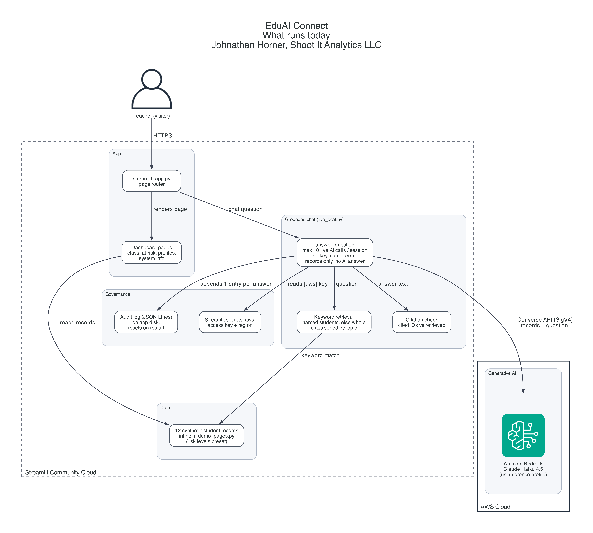

# EduAI Connect

**Status: Live.** The hosted app runs on Streamlit Cloud with a fixed sample of 12 synthetic
students and preset risk levels. Its chat answers questions with Claude Haiku 4.5 on Amazon Bedrock,
grounded in the student records it retrieves, when the app has AWS credentials; without them it
shows the matching records and says no AI answer was generated. Full mode (RAG and agents) runs
locally only; its accuracy has not been measured and it has never been deployed.

Independent reference project by Shoot It Analytics LLC. Built with public or synthetic data.

Live app (Streamlit Cloud): https://eduai-connect-horner.streamlit.app

## What it does

EduAI Connect is meant to help a teacher see which students may be falling behind and what to try
next, by asking plain-language questions about grades, attendance and engagement.

- **Hosted app** (`streamlit_app/streamlit_app.py`): a class dashboard, an at-risk list, student
  profiles and a system page, built on a fixed sample of 12 synthetic students whose risk levels are
  preset in the code, plus a chat page (`streamlit_app/live_chat.py`):
  - Retrieval: keyword matching. A question that names students gets only their records; any other
    question gets the whole class, ordered by the topic it asks about (risk, attendance, GPA,
    missing work or a subject). No embeddings.
  - Answer: Claude Haiku 4.5 on Amazon Bedrock (Converse API, `us.` inference profile), told to use
    only the retrieved records and cite their IDs. The records sent to the model are shown under
    every answer, and a citation of a record that was not retrieved is flagged.
  - Safety: credentials only from Streamlit secrets `[aws]`; at most 10 live AI requests per browser
    session; one audit log entry per answer (question, record IDs, model, tokens, cost, latency);
    with no credentials, a clearly labeled demo mode that shows records and no AI text.
- **Full mode** (AWS credentials): synthetic student records are embedded with Amazon Titan Text
  Embeddings v2 into a FAISS index and Claude 3 Haiku on Amazon Bedrock answers from the top 4
  matches. Query rewriting and re-ranking exist only in the command-line script `src/rag/rag_chain.py`. A LangGraph workflow runs a Grading Agent and an At-Risk Agent; the
  At-Risk Agent asks the model to apply three explicit criteria (grade below 70, attendance below
  0.80, engagement below 60). A FastAPI backend serves `/health`, `/chat`, `/insights/grading` and
  `/insights/at-risk`.
- An MCP server (`mcp_server.py`) gives MCP clients the same tool names; its tools return
  simulated values, not the app's analytics.

All student data is synthetic, in Canvas LMS API format. No real student records have been used.

## Case study

**EduAI Connect.** Lets a teacher ask plain questions about a class and get an answer from Claude Haiku 4.5 on Bedrock that uses only the student records it retrieved, with those records shown under the answer.

Status: **Live** · [Live app](https://eduai-connect-horner.streamlit.app) · [GitHub](https://github.com/johnathan-horner/eduai-connect) · [Portfolio](https://portfolio.johnathancloudspace.com/#eduai-connect)

### Real-world problem

About 28% of U.S. students were chronically absent in the 2022-23 school year, meaning they missed at least 10% of school days ([U.S. Department of Education](https://www.ed.gov/teaching-and-administration/supporting-students/chronic-absenteeism)). Teachers have the grades, attendance and engagement data that show who is slipping, but it is spread across systems and there is little time to read it.

### Why I built it

I wanted to see whether a chat answer about students can be something a teacher can check: built only from the records it retrieved, showing those records, and refusing to guess when something fails. I also wanted to map what a FERPA-aware version would need in the school's own AWS account.

### Version 1

The first version described a Canvas-to-Bedrock pipeline (EventBridge, Lambda, KMS-encrypted S3, Titan embeddings, FAISS, Claude 3 Sonnet and Bedrock Guardrails), and the app showed "FERPA Compliant", "Guardrails Active" and "KMS Encryption On" badges that the code did not back. I rebuilt it in October 2026 so the hosted chat really answers from Claude Haiku 4.5 using only the records it retrieved, and the README and app now say what is built and what is not.

### Key decisions

- **Two tiers: a light hosted app and a local RAG and agents stack.** The hosted chat finds records by keyword and makes one Bedrock call; LangGraph, FAISS and FastAPI stay local. There is no semantic search online, but the hosted app installs in seconds and makes exactly one model call per question.
- **Show the sources and check the citations instead of trusting the answer.** Every answer lists the records sent to the model, and any student ID it cites that was not retrieved is flagged. IDs are checked, facts are not, so a teacher still has to read.
- **Fail closed.** With no key, the cap reached or any error, the app shows the matching records and says no AI answer was generated. A broken key means no answers at all rather than a made-up one.
- **Small, capped model use.** Claude Haiku 4.5 through the US inference profile, 400 output tokens, temperature 0, 10 live calls per browser session and the cost shown per answer. Cheap and predictable, with less depth than a larger model.

### Architecture



The teacher's question goes to the grounded chat, which picks matching records by keyword (named students, or the whole class sorted by topic) and sends only those records and the question to Claude Haiku 4.5 on Amazon Bedrock. The answer comes back with the records underneath, a citation check and one audit log line. The repo also has CDK code for a production design (KMS-encrypted S3, an EventBridge-triggered ingestion Lambda, CloudWatch logs) that was never deployed and is not complete.

### Governance and safety

- Answers may use only the retrieved records and must cite record IDs; the records are shown under every answer.
- A citation check flags any student ID the answer cites that was not retrieved.
- Fail closed: no key, cap reached or any error shows records only, never generated text.
- 10 live calls per browser session; credentials only from the host's secret store.
- One audit log line per answer with the full question and answer text; on the free host it is wiped when the app restarts.
- The app states it is not FERPA compliant. Built: synthetic data only, the audit log, the session cap. Not built: sign-in, a PII guardrail on each call, CloudTrail, retention rules.

### Results

- 24 automated tests pass in CI, including 13 for the grounded chat run against a fake Bedrock client.
- Accuracy, false positives and hallucination rate have not been measured; there is no labelled evaluation set yet.

### What I got wrong

- **The app showed controls that weren't built.** Badges like "FERPA Compliant" came off, and the app and docs now mark each control as built, defined or not built.
- **The full stack could not run on the free host.** The RAG and agent modules open Bedrock clients and load FAISS as soon as they are imported, so the hosted app became a separate light tier with one model call per question.
- **The audit log keeps full text.** The privacy design asks for no student details in logs, but the chat log stores the full question and answer. It is documented as a gap to fix before any real student data.
- **Accuracy is still unmeasured.** There is no labelled evaluation set yet, so I state that instead of quoting a number.

### Constraints

- Synthetic student records only; never used with real students.
- Hosted on the free Streamlit tier, which cannot load the RAG and agent stack and has no IAM role, so the Bedrock key comes from the host's secret store.
- One Bedrock call per question and 10 live calls per browser session.
- When anything fails, the app shows records and no generated text.

### Limits

Synthetic data only: 12 student records in the hosted app with preset risk levels. Not FERPA compliant and not reviewed by any school, district or regulator.

### What I'd do in a real deployment

Run it in the school's AWS account behind sign-in with role-based access, apply a Bedrock PII guardrail to every call, keep the audit log in encrypted durable storage without full student text, and measure accuracy on a labelled set before a teacher relies on it.

### Sources

- [U.S. Department of Education: Chronic Absenteeism](https://www.ed.gov/teaching-and-administration/supporting-students/chronic-absenteeism)
- [Live app](https://eduai-connect-horner.streamlit.app)
- [GitHub](https://github.com/johnathan-horner/eduai-connect)
- [Portfolio](https://portfolio.johnathancloudspace.com/#eduai-connect)

Built by Johnathan Horner, Shoot It Analytics LLC

## Architecture

The architecture diagram and how it works are in the [Case study](#architecture) above.

## How to run

```bash
git clone https://github.com/johnathan-horner/eduai-connect.git
cd eduai-connect
```

Hosted app (no AWS account needed; the chat then runs in demo mode):

```bash
pip install -r requirements.txt
streamlit run streamlit_app/streamlit_app.py
```

To turn on live AI answers, add this to `.streamlit/secrets.toml` (never commit it) or to the app's
Secrets on Streamlit Cloud. The key needs only `bedrock:InvokeModel` on the Claude Haiku 4.5 `us.`
inference profile and its foundation model:

```toml
[aws]
access_key_id = "YOUR_ACCESS_KEY_ID"
secret_access_key = "YOUR_SECRET_ACCESS_KEY"
region = "us-east-1"
```

The chat audit log is written to `logs/chat_audit.jsonl` (set `EDUAI_AUDIT_LOG` to change it). On
Streamlit Cloud it resets whenever the app restarts.

Full mode (Python 3.11+, AWS credentials that can call Bedrock, model access for Claude 3 Haiku and
Titan Text Embeddings v2):

```bash
pip install -r requirements-full.txt
python3 src/etl/generate_data.py      # synthetic data
python3 src/rag/vector_store.py       # build the FAISS index
uvicorn src.api.main:app --reload     # API
streamlit run streamlit_app/app.py    # dashboard, in a second terminal
```

On an Intel Mac running macOS 12, install `faiss-cpu==1.10.0` first (newer versions have no wheel).

MCP server: `python3 mcp_server.py` (installed by `requirements-full.txt`).

Tests: `pip install pytest httpx` then `pytest`.

## Measured results

| What | Result | How |
|---|---|---|
| Automated tests | 24 (22 pass with `requirements.txt`; all 24 run in CI) | `pytest` |
| Chat, 3 live questions on Claude Haiku 4.5 | 3 of 3 cited only retrieved records; 1 answer overstated a fact (said Marcus had the lowest grade in every subject; true in 5 of 6); the question about data not in the records was answered "not in the records" | Run locally on 2026-10-23, total cost USD 0.0036 |
| At-risk accuracy, false positives, hallucination rate | Not measured | The evaluation notebook has no saved results |

## Limits

- Demo mode shows preset risk levels for 12 synthetic students. It does not compute them.
- Full mode retrieves only the top 4 records per question, so it can miss students.
- The dashboard's role selector (teacher or administrator) does not change which data is shown.
- The Bedrock Guardrail for PII is not applied, and there is no authentication.
- Chat answers can overstate what the records show. The source records are shown so a teacher can
  check, but nothing checks the facts automatically.
- The chat audit log lives on the app's disk and resets when the hosted app restarts.
- Synthetic data does not reflect real classrooms.

## What's next

- Measure the At-Risk Agent on a labeled synthetic set (precision and recall per risk level).
- Apply the guardrail to every model call and test it with PII red-team prompts.
- Compute demo-mode risk levels from the data instead of presetting them.
- Move `portfolio-index.html` out of this repo.

## More docs

- [docs/FERPA_COMPLIANCE.md](docs/FERPA_COMPLIANCE.md): privacy controls, built and not built
- [AI_SYSTEM_CARD.md](AI_SYSTEM_CARD.md): what the AI does and its limits
- `docs/decisions/`: architecture decision records
- [CONTRIBUTING.md](CONTRIBUTING.md)
